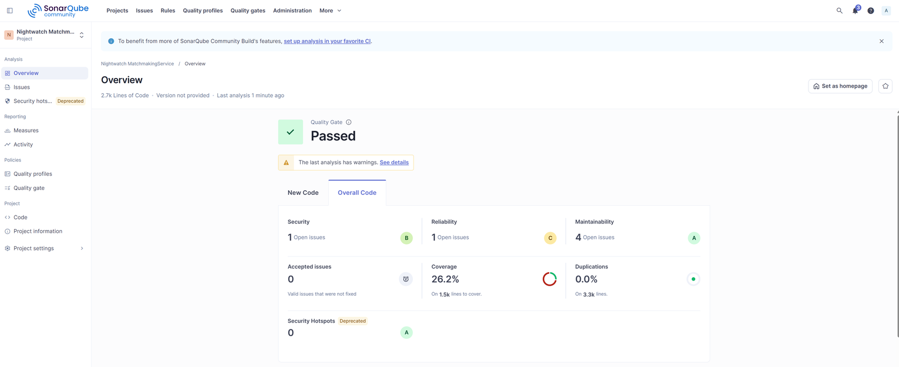

# 🎯 NP-MatchmakingService

[](https://github.com/JuanDeRe/NP-MatchmakingService/actions/workflows/ci.yml)

Queue, waiting-room and match-creation service of [Nightwatch Protocol](https://github.com/Nightwatch-Protocol/nightwatch-protocol).

## What it does
- **Queue / waiting rooms:** players join an open waiting room; rooms have a status, capacity (2–5 players, configurable) and a **countdown** before the match starts
- **Friends:** a player can create a room and share its **invite code**; others join with `POST /matchmaking/rooms/join-by-code` (handles not-found, full and unavailable rooms)
- Prevents a player from joining twice
- **Assigns roles** when the match is created: one Guard and animatronics (Foxy, Chica, Bonnie, Freddy)
- Picks a **Game Service instance with free capacity** (from a Redis registry fed by instance heartbeats) and asks it to create the match
- Retries when the Game Service fails once (covered by tests with a fail-once fake)
- Consumes the **match-finished events** from a Redis Stream to release players
- Publishes queue/match metrics to **CloudWatch**; `/health` for the ALB

## Endpoints
`POST /matchmaking/join` · `GET /matchmaking/status/{playerId}` · `GET /matchmaking/rooms` · `POST /matchmaking/rooms/join-by-code` · `POST /matchmaking/process-waiting-rooms`

## What was achieved
Players go from login to a running match without any host machine: rooms fill, a countdown runs, roles are assigned and the match is created on a backend instance chosen by available capacity. State lives in Redis, so the service is horizontally scalable.

## Tech stack
C# · .NET 9 · ASP.NET Core · Redis (state, registry, Streams) · CloudWatch · Docker · xUnit with fakes · GitHub Actions

## Run locally
```bash
docker run -p 6379:6379 redis   # or use the in-memory store
dotnet test
dotnet run
```
Config: `GameService__BaseUrl`, `Redis__ConnectionString`, `Matchmaking__*`, `Cors__AllowedOrigins__0`.

## Design
- **Least-loaded placement:** a new match goes to the Game Service instance with the fewest active matches (read from the Redis registry)
- **Background workers:** `WaitingRoomProcessor` (countdowns and match creation), `MatchEventStreamProcessor` and `MatchFinishedSubscriber` (Redis Streams)
- **Dependency inversion:** `IGameServiceClient`, `IMatchmakingStore` (in-memory and Redis implementations) and `IGameServiceRegistry` make the service testable with fakes

## Code quality
Analyzed with **SonarQube Community**: quality gate **passed**, 2.7k lines of code, **26.2% coverage** on 1.5k coverable lines, **0.0% duplication**.



## Tests
xUnit tests cover role assignment, duplicate-entry prevention, room joining and Game Service failure/retry using fake clients and registries.

## Notes / limitations
- Endpoints do not validate the caller's JWT yet; the `playerId` comes from the request body.
- `process-waiting-rooms` is an open endpoint (also run by a background processor).

## Part of Nightwatch Protocol
[Main repo](https://github.com/Nightwatch-Protocol/nightwatch-protocol) · [Unity Client](https://github.com/JuanDeRe/Nightwatch-Protocol-Unity-Client) · [Auth](https://github.com/JuanDeRe/NP-AuthService) · **Matchmaking** · [Gateway](https://github.com/JuanDeRe/NP-RealtimeGateway) · [Game Service](https://github.com/JuanDeRe/NP-GameService) · [Terraform](https://github.com/JuanDeRe/NP-Terraform)
